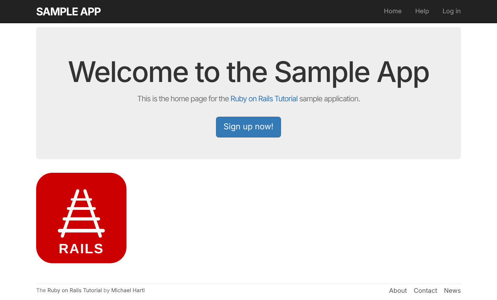
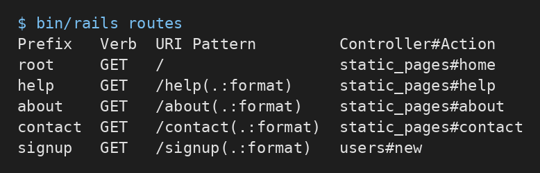
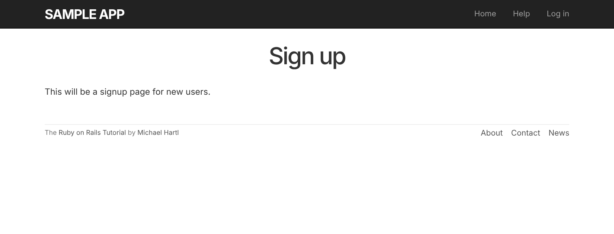
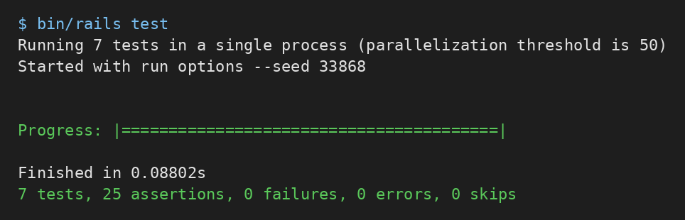

# Лабораторная работа №5. Заполнение макета

Учебное приложение sample app по книге *Ruby on Rails Tutorial* (глава 5).
Проект продолжает лабораторную работу №4.

Выполнил: Мифтахов Р. Н., группа 4411.

## Что сделано

- подключён Bootstrap 3 и собственные стили на Sass (`app/assets/stylesheets/application.scss`, гем `dartsass-rails`);
- макет разбит на частичные шаблоны `_header.html.erb` и `_footer.html.erb`;
- именованные маршруты: `root`, `/help`, `/about`, `/contact`, `/signup`;
- контроллер `Users` с действием `new` — заготовка страницы регистрации;
- интеграционный тест ссылок макета `test/integration/site_layout_test.rb` и тест хелпера `full_title`.

## Запуск

```sh
bundle install
bin/rails dartsass:build   # собрать CSS из Sass
bin/rails test             # тесты
bin/dev                    # сервер + слежение за Sass, http://localhost:3000
```

Отчёт по работе: `Отчет_ЛР5_Мифтахов.docx`.

## Краткий отчёт

**Теория.** Макет (layout) — общий шаблон, в который на место `yield` подставляется содержимое страницы. Повторяющиеся части выносятся в частичные шаблоны и подключаются через `render`. Bootstrap даёт готовые CSS-классы, Sass добавляет к CSS переменные и вложенные правила. Именованные маршруты создают методы вида `help_path`.

**Макет.** Шапка и подвал вынесены в `_header.html.erb` и `_footer.html.erb`, стили — в `application.scss`:



**Маршруты.** `config/routes.rb` задаёт короткие адреса и маршрут регистрации:



**Страница регистрации.** Контроллер `Users`, действие `new`:



**Тесты.** Интеграционный тест ссылок макета и тест хелпера `full_title`:



**Вывод.** Приложение получило оформленный макет с навигацией и подвалом; освоены Bootstrap, Sass, частичные шаблоны, именованные маршруты и интеграционные тесты.
